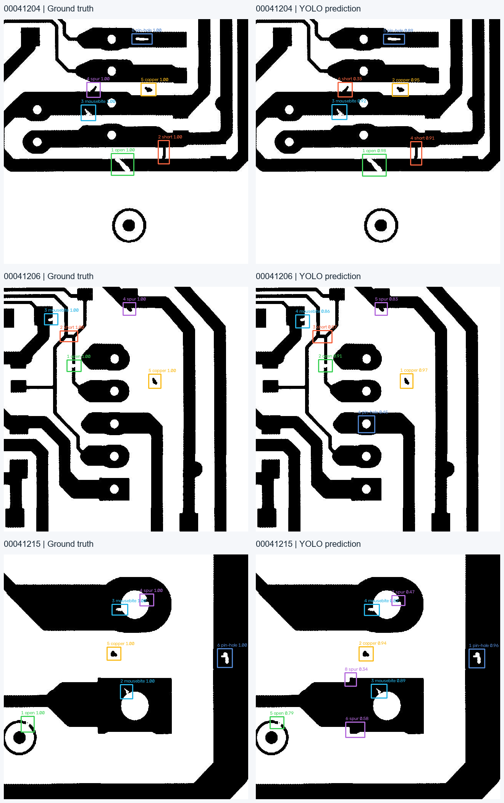

# PCB Inspector · 电路板缺陷检测与复核系统

面向机器视觉 / YOLO 应用工程师求职的个人作品。用 YOLO11n 检测六类 PCB 缺陷，并用 OpenCV 模板差分建立传统视觉基线；包含可复现数据处理、真实训练、独立测试、检测界面及人工复核。

**项目状态与实测数字以 `reports/evaluation.json`、`models/model_card.json` 为准。没有评估文件时，不代表已经完成模型验证。**

交付说明：[实测报告](reports/experiment-report.md) · [简历项目描述](docs/resume-project.md) · [面试讲解](docs/interview-guide.md) · [选题比较](docs/project-selection.md)



实测：320 张训练 / 80 张验证 / 150 张测试；测试集 **mAP50 84.26% / mAP50-95 57.30%**。这是公开数据集上的个人项目结果，尚未经过工厂现场验证。

## 快速运行

在本目录打开 PowerShell：

```powershell
.\start.ps1
```

浏览器访问 http://127.0.0.1:8517 。选择独立测试样例，点击“开始检测”。首次启动会加载本地模型。

新电脑需 Python 3.12，先执行 `setup.ps1` 安装依赖。仓库包含训练好的 `models/pcb_yolo11n.pt` 和模型卡，无需重新训练即可上传 PCB 图片进行检测。测试样例列表需要先执行下文的数据下载和转换步骤；数据集与虚拟环境不随仓库分发。

```powershell
git clone https://github.com/sbzz666/pcb-inspector.git
cd pcb-inspector
.\setup.ps1
.\start.ps1
```

## 实现的技术内容

- **数据工程**：原始 xyxy + 1-based 类别转换为 YOLO 归一化 xywh + 0-based 类别；坐标合法性检查；图像 ID 和解码像素 SHA256 去重审计。
- **训练与选择**：COCO 预训练 YOLO11n 微调；固定种子；保留最佳权重、训练 CSV、超参数及模型 SHA256；只用验证集选择部署置信度。
- **小目标推理**：全图检测与重叠切片，映射回原图后按类别做全局 NMS，覆盖末端边界；不预设切片必然提升精度。
- **传统视觉**：Otsu 二值化、边缘位移容忍、模板差分、形态学闭运算、连通域过滤；可选 ECC 平移配准。
- **评估**：mAP50、mAP50-95、固定 IoU=0.5 的 P/R/F1、逐图误检漏检记录、预热后的 CPU 推理中位数和 P95。
- **应用交付**：Streamlit 中文工作台、图像上传、测试样例、置信度调节、人工复核、SQLite 追加记录、图片/JSON 导出、批量命令行。
- **质量验证**：坐标转换、匹配唯一性、类别判定、切片覆盖、去重、配准、模板异常、复核持久化与 UI 页面测试。

## 从零复现实验

```powershell
# 1. 固定哈希抽样：400 张原 trainval + 150 张原 test；不按标签挑选图片
.\.venv\Scripts\python.exe scripts/download_data.py

# 2. trainval 内按来源 group 分层，80% train / 20% val
.\.venv\Scripts\python.exe -m pcb_inspector.dataset

# 3. 从 Ultralytics 官方 Hugging Face 仓库下载初始模型
.\.venv\Scripts\python.exe scripts/download_weights.py

# 4. CPU 训练。需要更强实验时可调整 epochs、imgsz；CUDA 机器可传 --device 0
.\.venv\Scripts\python.exe scripts/train.py --epochs 30 --imgsz 320 --batch 8 --device cpu

# 5. 验证集选阈值，再对测试集评估
.\.venv\Scripts\python.exe scripts/calibrate_baseline.py
.\.venv\Scripts\python.exe scripts/evaluate.py --imgsz 320
.\.venv\Scripts\python.exe scripts/build_report.py

# 6. 测试 / 批量推理
.\.venv\Scripts\python.exe -m pytest -q
.\.venv\Scripts\python.exe scripts/predict.py data/processed/images/test --output reports/batch_demo
```

完整数据下载使用 `scripts/download_data.py --full`。重新划分前需显式清理旧的 `data/processed` 或使用新项目副本；转换脚本会拒绝覆盖已有 manifest，防止旧图片混入新实验。增大样本或改变训练配置需要重新训练和评估。

训练被中断时，可运行 `scripts/train.py --resume runs/pcb_yolo11n/weights/last.pt`，保留已完成轮次。完整安装版本记录在 `requirements-lock.txt`，可用 `pip install -r requirements-lock.txt` 复现当前环境。

## 评估协议与边界

1. 默认是 **550 张图像的 CPU 作品集子集**，不是完整 1,500 对数据集实验。实际划分与类别统计见 `reports/data_audit.json`。
2. 保留原作者 trainval/test 列表归属，trainval 内固定哈希排序分出验证集；训练、验证、测试图片不重叠。**不同集合可能包含相同 PCB group，不是跨版型泛化验证。**
3. 阈值只根据验证集微平均 F1 选择；最终测试指标不得用于反复选阈值。切片模式是独立功能，主评估报告默认只衡量全图检测。
4. OpenCV 基线需要额外的无缺陷模板，且不输出六类缺陷名称。因此与 YOLO 比较的是 **类别无关定位指标**，六类检测指标单独报告。
5. 延迟测量不含读盘、模型加载和绘图，不等同于相机到报警的端到端实时性能。CPU 存在并发负载，不能与其他硬件结果直接排名。
6. DeepPCB 图片由原作者预处理并配准，包含人工补充缺陷。数据集结果不能外推到现场反光、失焦、运动模糊、真实生产良品比例。
7. 没有检测到框不能判定产品合格。系统保留人工复核入口；不接 PLC，不自动控制产线。

## 文件布局

```text
app.py                      中文检测与复核工作台
pcb_inspector/dataset.py     标注转换、划分、审计
pcb_inspector/vision.py      YOLO / 切片 / NMS / OpenCV
pcb_inspector/metrics.py     一对一检测匹配与固定阈值指标
pcb_inspector/review.py      SQLite 复核快照
scripts/download_data.py    原作者数据下载
scripts/train.py             训练与模型卡
scripts/evaluate.py          验证集阈值选择、独立测试报告
scripts/predict.py           批量推理
models/                     初始化权重、训练权重、模型卡
reports/                    审计、评估、逐图结果、失败案例
docs/                       求职选题依据、面试讲解与简历建议
```

## 数据和许可

- [DeepPCB 原作者仓库](https://github.com/tangsanli5201/DeepPCB)：原仓库 MIT License，保留下载的 LICENSE 和原 README。
- [DeepPCB 论文](https://arxiv.org/abs/1902.06197)：Online PCB Defect Detector On A New PCB Defect Dataset。
- [Ultralytics](https://github.com/ultralytics/ultralytics)：依赖代码及权重按其发布许可使用；本项目采用 AGPL-3.0，完整许可文本见 LICENSE。
- 模型训练和推理在本地完成，不调用外部模型 API，无需账号或密钥。上传图片不自动持久化，复核记录存入本地 `reports/reviews.sqlite3`。

本项目是 AI 辅助完成的个人学习作品。简历应明确个人项目身份，理解后再写自己的实际职责，不应写成企业实习或生产经历。
